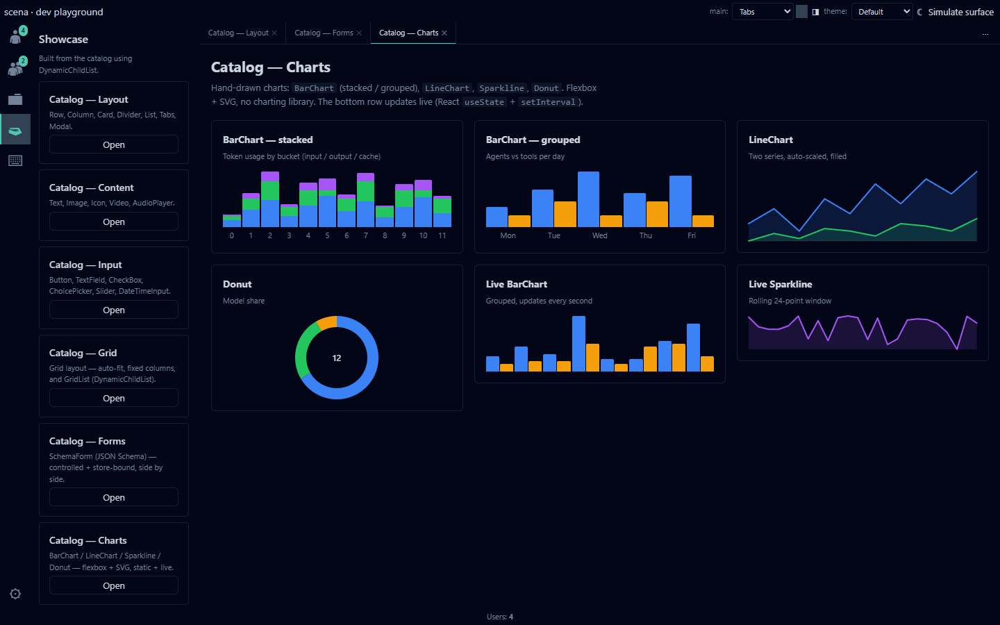
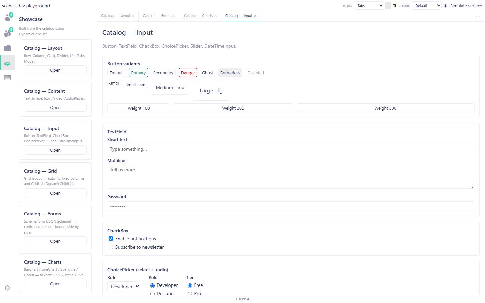
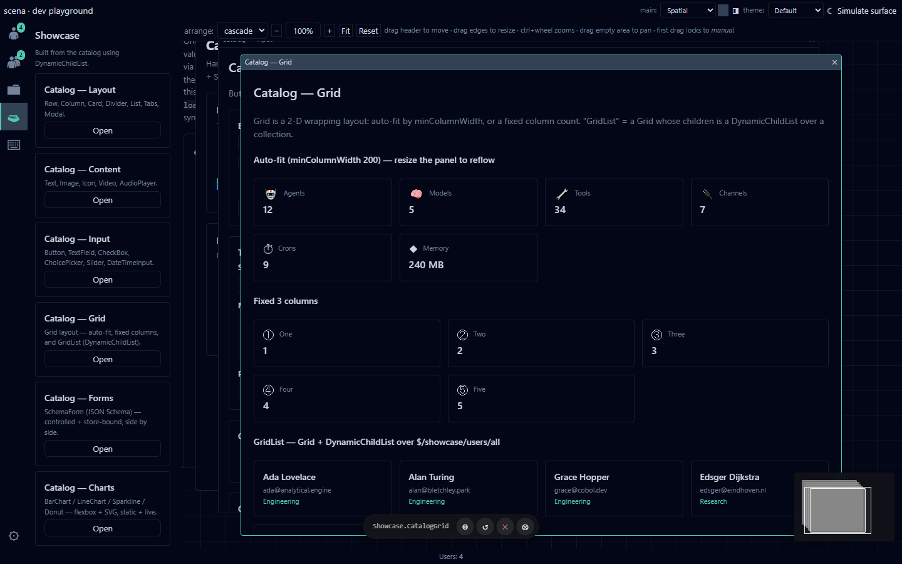
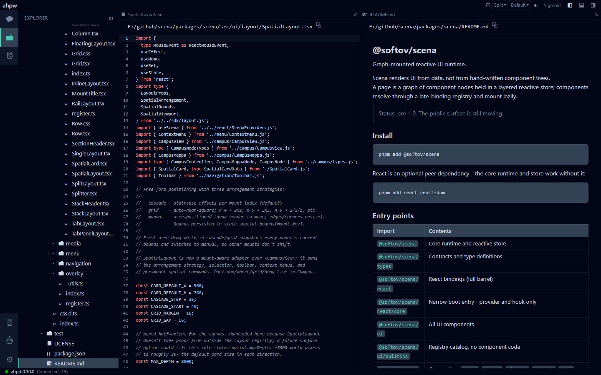
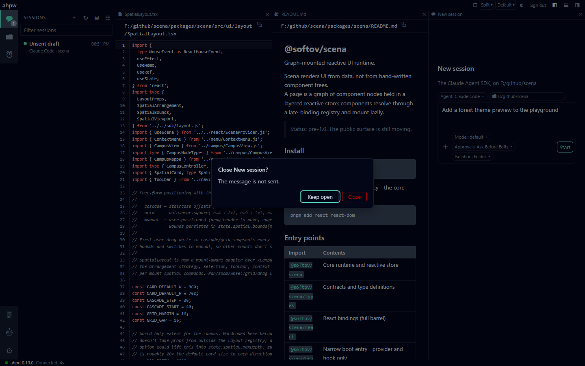
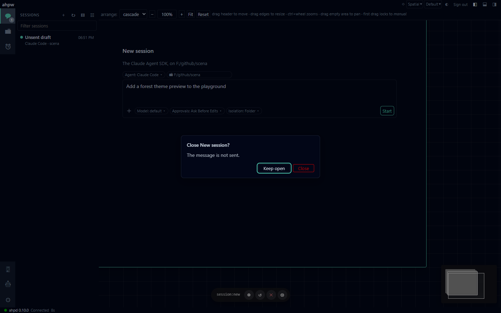
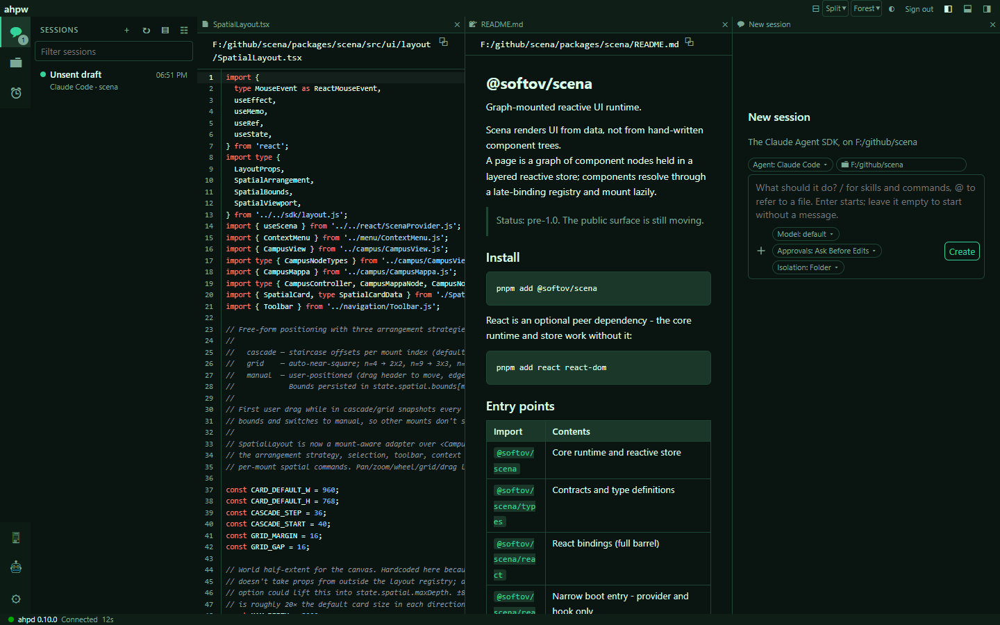

<p align="center">
  
</p>

<h1 align="center">scena</h1>

<p align="center">
  A reactive UI runtime that renders pages from data.
</p>

<p align="center">
  <a href="https://www.npmjs.com/package/@softov/scena"></a>
  <a href="https://github.com/softov/scena/actions/workflows/ci.yml"></a>
  <a href="https://www.npmjs.com/package/@softov/scena"></a>
  <a href="LICENSE"></a>
  
  
</p>



## What it is

Scena renders UI from data, not from hand-written component trees.
A page is a graph of component nodes.
The graph lives in a layered reactive store.
The runtime finds each component by name in a registry, mounts it when it is needed, and renders it again when its data changes.
Because no page imports a component, you can save a page, send it over a socket, edit it, or generate it.

> Status: pre-1.0. The public API can still change.

## What you get

- **A reactive store.** One scoped tree of values. Components bind to paths in it.
- **A component graph.** Pages are data. You can persist, transport and generate them.
- **Late-binding registries.** Components, commands, layouts and shells resolve by name when they mount.
- **Surfaces and layouts.** Mount pages into named surfaces. Show them as tabs, tab groups, splits, stacks, or cards on a spatial canvas.
- **A component catalog.** Forms, data tables, charts, menus, markdown, and more.
- **Themes.** Seven built-in themes, each with a light and a dark mode, all driven by CSS tokens.
- **Sign-in.** A sign-in wall and session handling, with pluggable providers.

| Light mode | Spatial layout |
| --- | --- |
|  |  |

## Built with scena

### ahpw

[ahpw](https://github.com/softov/ahpw) is a web UI for [Agent Host Protocol](https://github.com/microsoft/agent-host-protocol) hosts.
It shows sessions, files, terminals and automations from one or more hosts.
It runs on its own with `ahpw serve`, as an ahpd plugin (`@ahpd/web`), or inside the [ahp-desk](https://github.com/softov/ahp-desk) desktop app.
Every view in it is a scena page.



A page with pending work asks before it closes.
The same question shows in every layout.

| Split layout | Spatial layout, closed with Esc |
| --- | --- |
|  |  |

Themes restyle the whole app, not only scena's own parts.
This is ahpw in the built-in `forest` theme, dark mode.



Do you build on scena? Open a pull request to add your project here.

## Install

```bash
pnpm add @softov/scena
```

React is an optional peer dependency.
The store and the runtime work without it.
Add React for the bindings and the component catalog:

```bash
pnpm add react react-dom
```

To build an application, start with [`docs/consuming.md`](docs/consuming.md).

## Documentation

| Document | What it answers |
| --- | --- |
| [`docs/README.md`](docs/README.md) | The words that the other documents use |
| [`docs/architecture.md`](docs/architecture.md) | The model: store, graph, registries, surfaces, shells |
| [`docs/consuming.md`](docs/consuming.md) | How to build an application on scena, and the mistakes to avoid |
| [`docs/ui.md`](docs/ui.md) | The component catalog and the theme tokens |
| [`DEVELOPER.md`](DEVELOPER.md) | How to work on scena itself: setup, checks, testing in an app, releases |

## Packages

| Package | Description |
| --- | --- |
| [`@softov/scena`](packages/scena) | The runtime and its contracts. Published to npm. |
| `@softov/scena-playground` | A dev app and component showcase. It reads `packages/scena/src` directly. Private. |
| [`@softov/scena-demo`](packages/demo) | A small reference app. It uses the published exports, so it finds packaging errors that the playground hides. Private. |

`@softov/scena` is one package with layered entry points:

| Entry | What it is |
| --- | --- |
| `@softov/scena` | The root: core, with the runtime on top |
| `@softov/scena/sdk` | The contracts and the pure functions over them. No dependencies |
| `@softov/scena/core` | The store, the graph, the resolvers and the registries |
| `@softov/scena/runtime` | The surface bridge, sockets, and the layout and opener commands |
| `@softov/scena/react` | The React bindings. `/react/core` is the small boot entry |
| `@softov/scena/ui` | The component catalog. `/ui/<section>` loads one section |
| `@softov/scena/porta` | Sign-in |
| `@softov/scena/styles` | The theme registry and the stylesheets |

`@softov/scena/types` is the old name of `/sdk`. It still works.

## Contributing

Read [`DEVELOPER.md`](DEVELOPER.md) to set up, run the checks, and try a change in an app before a release.
Agents and their humans: read [`AGENTS.md`](AGENTS.md) for the conventions.

## License

[MIT](LICENSE)
